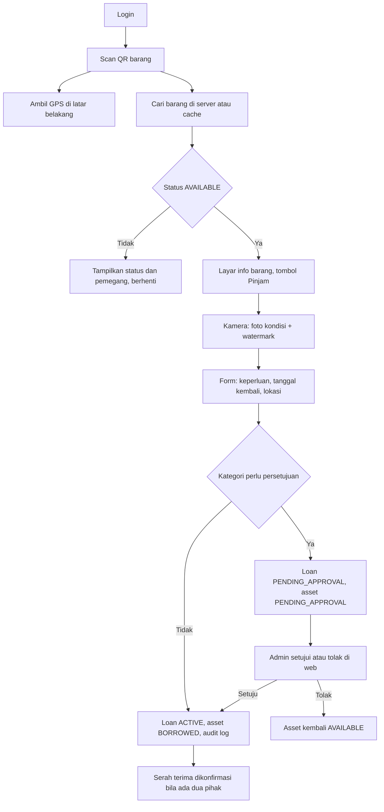
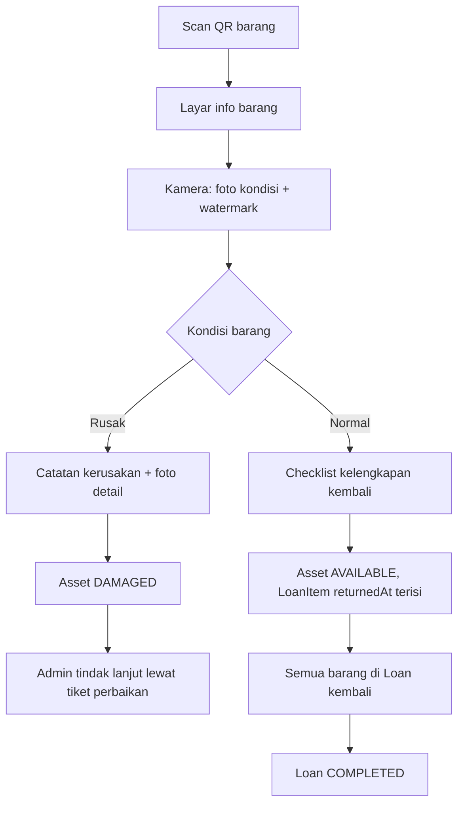
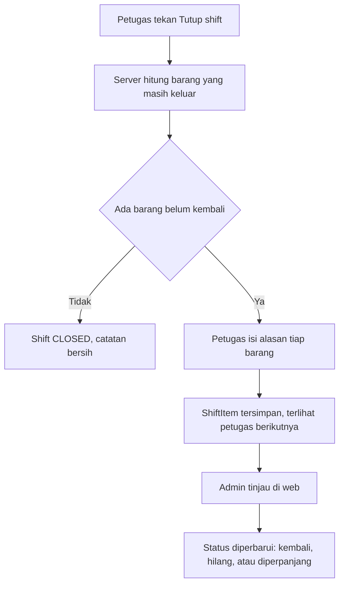
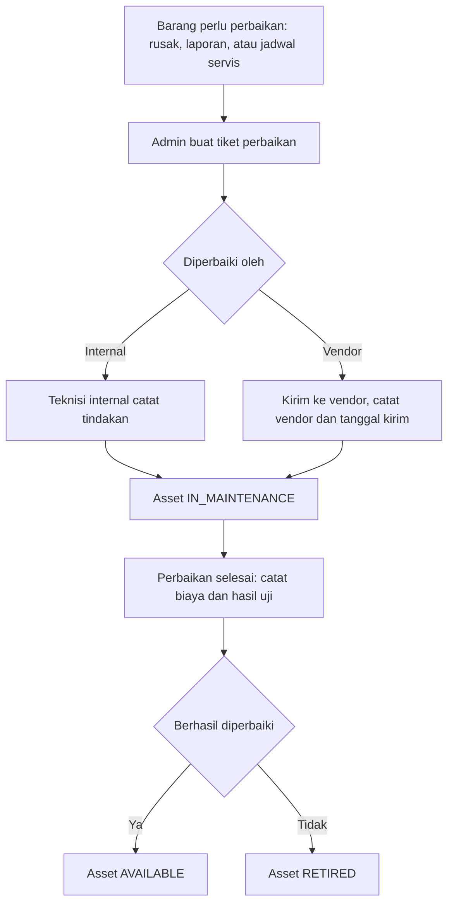
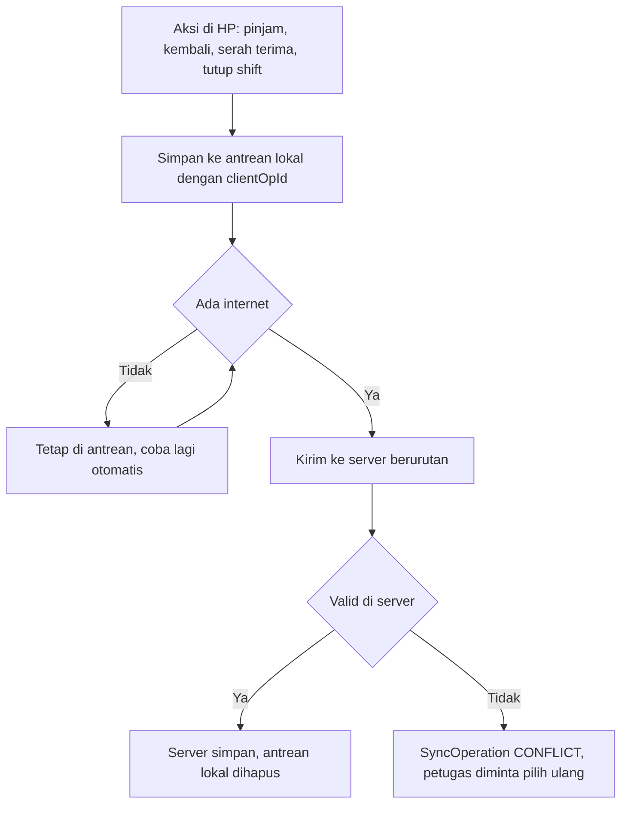

# SPESIFIKASI PROYEK: Sistem Manajemen Aset IT (ITAM) dengan Web Admin dan Aplikasi Android

> Dokumen ini ditulis agar bisa dibaca, dirancang, dan dikerjakan oleh AI agent (atau developer manusia) tanpa konteks tambahan.
> Bahasa dokumen: Indonesia. Identifier kode (nama tabel, field, endpoint, enum): Inggris. Teks antarmuka aplikasi: Indonesia.
> Status dokumen: hasil perancangan awal. Bagian yang belum diputuskan pemilik ditandai **[TERBUKA]** dan dikumpulkan di Bagian 21.

---

## 0. CARA MEMAKAI DOKUMEN INI (WAJIB DIBACA AGEN)

1. **Baca seluruh dokumen sebelum menulis kode.** Jangan mulai dari satu bagian saja.
2. **Sumber kebenaran:** bila ada konflik antar bagian, prioritasnya: Bagian 6 (Aturan Bisnis) > Bagian 5 (Model Data dan Status) > bagian lain.
3. **Jangan mengarang kebutuhan.** Untuk hal bertanda **[TERBUKA]**: tanyakan ke pemilik proyek. Kalau tidak bisa bertanya, pakai nilai bawaan (default) yang tertulis, lalu catat asumsinya di `docs/ASSUMPTIONS.md`.
4. **Kerjakan per milestone (Bagian 19).** Jangan lanjut ke milestone berikutnya sebelum kriteria penerimaan milestone sekarang terpenuhi dan diuji.
5. **Validasi dan otorisasi selalu di server.** Klien (web/Android) hanya untuk kenyamanan tampilan, tidak boleh dipercaya.
6. **Setiap perubahan status data bersifat transaksional:** ubah data + tulis `AuditLog` dalam satu transaksi database.
7. **Tidak ada hard delete** untuk `Asset`, `Loan`, `Evidence`, `AuditLog`. Gunakan status (`RETIRED`, `CANCELLED`, dst.).
8. **Rahasia (password, kunci, token) tidak boleh masuk Git.** Gunakan `.env` dan sediakan `.env.example` tanpa nilai asli.
9. **Tulis test untuk aturan kritis** (Bagian 20): pinjam ganda, sinkronisasi idempoten, hak akses, penilaian risiko.
10. **Verifikasi versi dan API library sebelum menulis kode** (Prisma, SvelteKit, Capacitor, plugin kamera/GPS). API library sering berubah; baca dokumentasi resmi versi yang dipasang, jangan mengandalkan ingatan.
11. **Kalau sebuah kebutuhan di dokumen ini ternyata tidak bisa dipenuhi secara teknis** (mis. plugin tidak mendukung deteksi mock location), jangan diam-diam diganti. Catat di `docs/DEVIATIONS.md` beserta alasan dan alternatifnya, lalu beri tahu pemilik.
12. Setelah tiap milestone, tulis ringkasan singkat: apa yang selesai, apa yang belum, asumsi yang diambil, dan cara menjalankannya.

---

## 1. RINGKASAN PROYEK

**Tujuan:** melacak lokasi, status, dan pemegang barang IT yang dipakai untuk seminar dan keperluan lain, mencatat peminjaman dan pengembalian, serta serah terima barang antar orang atau antar shift, dengan bukti yang bisa diaudit.

**Dua antarmuka, satu data:**

- **Web (admin/koordinator):** kelola data, setujui peminjaman, pantau dashboard, tinjau bukti dan risiko, laporan, perbaikan.
- **Android (petugas/peminjam di lapangan):** scan QR, pinjam, kembalikan, foto bukti bertanda lokasi dan waktu, serah terima, tutup shift. Harus tetap bisa bekerja saat sinyal lemah atau mati.

**Prinsip desain:**

1. Satu backend dan satu database; web dan Android adalah klien dari API yang sama.
2. Sesederhana mungkin untuk dirawat: monolith kecil, bukan microservices.
3. Bukti dan jejak audit adalah inti nilai sistem (siapa, kapan, di mana, kondisi apa).
4. Kegagalan GPS atau sinyal tidak boleh menghentikan pekerjaan lapangan; ketidakpastian ditandai, bukan diblokir (kecuali kasus pasti, lihat Bagian 9).

---

## 2. RUANG LINGKUP

### 2.1 Fase fitur

| Fase             | Isi                                                                                                                                                                                                                                                                                                                                          |
| ---------------- | -------------------------------------------------------------------------------------------------------------------------------------------------------------------------------------------------------------------------------------------------------------------------------------------------------------------------------------------- |
| **Fase 1 (MVP)** | Login + role, master data (barang, kategori, lokasi, user), impor CSV, cetak QR, scan pinjam/kembali dengan foto bertanda lokasi dan waktu, pencegahan pinjam ganda, pencarian manual, serah terima, tutup shift, log aktivitas, antrean offline + sinkronisasi, dashboard dasar, penilaian risiko dasar (mock location, selisih jam, jarak) |
| **Fase 1.5**     | Pinjam banyak barang (keranjang), checklist kelengkapan, persetujuan peminjaman, tiket perbaikan dan perawatan, halaman tinjau risiko, berita acara PDF, notifikasi dan eskalasi keterlambatan, laporan dan ekspor                                                                                                                           |
| **Fase 2**       | Stock opname (mode audit), reservasi tanggal, paket seminar, QR lokasi, pembatasan perangkat (Play Integrity), statistik lanjutan                                                                                                                                                                                                            |

### 2.2 Di luar cakupan (sengaja tidak dikerjakan)

SSO perusahaan, integrasi ERP, pelacakan real-time dengan tag Bluetooth/GPS tracker, pelacakan lokasi terus-menerus di HP pengguna, aplikasi iOS.

---

## 3. PENGGUNA DAN HAK AKSES

### 3.1 Peran

| Role (enum) | Label    | Deskripsi                                                                    |
| ----------- | -------- | ---------------------------------------------------------------------------- |
| `ADMIN`     | Admin    | Mengelola data, menyetujui, meninjau laporan, memutuskan barang rusak/hilang |
| `OFFICER`   | Petugas  | Menjalankan serah terima, pengembalian, tutup shift                          |
| `BORROWER`  | Peminjam | Scan dan meminjam, mengembalikan barang yang ia pinjam                       |

### 3.2 Matriks hak akses

| Aksi                                                       | ADMIN |              OFFICER               |           BORROWER            |
| ---------------------------------------------------------- | :---: | :--------------------------------: | :---------------------------: |
| Login, scan QR, lihat info barang                          |  Ya   |                 Ya                 |              Ya               |
| Kelola user, kategori, lokasi, barang, impor CSV, cetak QR |  Ya   |               Tidak                |             Tidak             |
| Membuat peminjaman                                         |  Ya   |                 Ya                 |      Ya (untuk dirinya)       |
| Menyetujui / menolak peminjaman                            |  Ya   |               Tidak                |             Tidak             |
| Mengembalikan barang                                       |  Ya   |                 Ya                 |   Hanya peminjaman miliknya   |
| Konfirmasi serah terima                                    |  Ya   |                 Ya                 | Ya (sebagai penerima/pemberi) |
| Buka / tutup shift                                         |  Ya   |                 Ya                 |             Tidak             |
| Membuat tiket perbaikan                                    |  Ya   |            Ya (melapor)            |             Tidak             |
| Mengubah status tiket, menetapkan hasil                    |  Ya   |               Tidak                |             Tidak             |
| Menetapkan status `LOST` / `RETIRED`                       |  Ya   |               Tidak                |             Tidak             |
| Melihat semua peminjaman dan laporan                       |  Ya   | Peminjaman + shift yang ia tangani |      Peminjaman miliknya      |
| Melihat peta, risiko, audit log                            |  Ya   |               Tidak                |             Tidak             |
| Mencabut sesi login pengguna                               |  Ya   |               Tidak                |             Tidak             |

Implementasi: satu fungsi kebijakan terpusat `can(user, action, resource)` di server; setiap endpoint memanggilnya. Jangan menyebar `if role === ...` di banyak tempat.

---

## 4. ARSITEKTUR DAN STACK

### 4.1 Diagram

```
[Web Admin]   ─┐
               ├──► API /api/v1 (satu aplikasi) ──► PostgreSQL
[App Android] ─┘                │
                                ├──► Storage foto privat (MinIO / S3-compatible)
                                └──► Job terjadwal (keterlambatan, servis berkala, retensi)
```

### 4.2 Rekomendasi stack

> Status: **rekomendasi hasil diskusi, belum dikonfirmasi final oleh pemilik** (lihat Bagian 21, butir 1). Struktur data, API, dan aturan bisnis tidak bergantung pada pilihan frontend.

| Lapisan      | Pilihan                                                                            |
| ------------ | ---------------------------------------------------------------------------------- |
| Bahasa       | TypeScript di semua lapisan                                                        |
| Web + API    | SvelteKit (full-stack) + Tailwind CSS                                              |
| Android      | Capacitor membungkus UI SvelteKit                                                  |
| Database     | PostgreSQL                                                                         |
| ORM          | Prisma                                                                             |
| Validasi     | Zod (skema bersama untuk server dan klien)                                         |
| Login        | JWT access token + refresh token (rotasi)                                          |
| Storage foto | MinIO (self-hosted) atau S3-compatible; simpan kunci objek di DB, bukan URL publik |
| Deploy       | Docker Compose + Caddy di satu VPS                                                 |
| Pantau error | Sentry (web dan Android) + Uptime Kuma                                             |
| Log          | `pino` (JSON terstruktur)                                                          |

### 4.3 Alternatif dan kondisi yang mengubah pilihan

- **Next.js + React Native (Expo):** dipilih bila fitur offline ternyata kebutuhan utama (petugas bekerja berjam-jam tanpa sinyal). Penyimpanan lokal dan sinkronisasinya lebih matang di React Native.
- **Go di backend:** lebih ringan dan stabil, tetapi menambah dua bahasa dan tipe/validasi ganda. Hanya dipertimbangkan bila prioritas utama efisiensi jangka panjang.
- **NestJS terpisah:** dipertimbangkan bila proyek tumbuh besar dan butuh struktur modul ketat.

### 4.4 Catatan arsitektur penting untuk SvelteKit + Capacitor

Aplikasi Android (Capacitor) memuat **build statis** dan tidak menjalankan server SvelteKit. Konsekuensinya:

1. **Layar yang dipakai di Android tidak boleh bergantung pada `+page.server.ts`, form actions server-side, atau `load` yang berjalan di server.** Semua data diambil lewat `fetch` ke `/api/v1/...` dari sisi klien.
2. Gunakan dua target build dari satu codebase:
   - `server`: `adapter-node` (melayani web admin + API).
   - `mobile`: `adapter-static` mode SPA (hanya rute `/m/*`), `ssr = false`, `API_BASE_URL` menunjuk ke domain server.
3. Rute dipisah: `/admin/*` untuk web admin, `/m/*` untuk layar Android, `/api/v1/*` untuk API.
4. Bila pemisahan ini menimbulkan hambatan besar, agen boleh mengusulkan struktur monorepo (`apps/server`, `apps/mobile`, `packages/shared`). Catat di `docs/DEVIATIONS.md` sebelum mengubah.
5. Plugin native yang dibutuhkan: kamera, geolocation, penyimpanan lokal (SQLite), penyimpanan aman untuk token, jaringan (status online/offline), notifikasi lokal/push. **Verifikasi tiap plugin, terutama kemampuan membaca penanda mock location (lihat 9.3).**

---

## 5. MODEL DATA DAN STATUS

### 5.1 Skema Prisma lengkap

Sumber kebenaran skema ada di bawah ini (juga tersedia sebagai `prisma/schema.prisma`). Catat: blok `generator`/`datasource` mengikuti gaya Prisma yang umum; versi Prisma terbaru mengubah cara penulisannya, jadi sesuaikan dengan dokumentasi versi yang dipasang. Model dan relasi tidak terpengaruh.

```prisma
// =====================================================================
// SISTEM MANAJEMEN ASET IT - Skema Database (Prisma + PostgreSQL)
// Cakupan: Versi 1 + 1.5 (inti, keranjang, kelengkapan, perbaikan, risiko GPS)
//
// Catatan:
// - Blok generator/datasource di bawah mengikuti gaya Prisma yang umum.
//   Versi Prisma terbaru mengubah cara penulisannya, jadi cocokkan dengan
//   dokumentasi versi yang kamu pasang.
// - Semua waktu disimpan dalam UTC, ditampilkan sesuai zona pengguna.
// - Aturan penting yang TIDAK bisa ditulis di Prisma ada di bagian
//   "CONSTRAINT TAMBAHAN (SQL)" paling bawah. Wajib dipasang lewat migrasi.
// =====================================================================

generator client {
  provider = "prisma-client-js"
}

datasource db {
  provider = "postgresql"
  url      = env("DATABASE_URL")
}

// ---------------------------------------------------------------------
// ENUM
// ---------------------------------------------------------------------

enum Role {
  ADMIN       // kelola barang & user, setujui, lihat semua laporan
  OFFICER     // petugas: serah terima, pengembalian, tutup shift
  BORROWER    // peminjam: scan dan pinjam
}

enum AssetStatus {
  AVAILABLE         // Tersedia
  PENDING_APPROVAL  // Menunggu persetujuan
  BORROWED          // Dipinjam
  DAMAGED           // Rusak (menunggu keputusan admin)
  IN_MAINTENANCE    // Dalam perbaikan
  LOST              // Hilang (hanya ditetapkan admin)
  RETIRED           // Afkir (status akhir, tidak dihapus)
}

enum LoanStatus {
  PENDING_APPROVAL
  REJECTED
  ACTIVE
  COMPLETED
  CANCELLED
}

enum ItemCondition {
  NORMAL
  DAMAGED
}

enum EvidencePurpose {
  CHECKOUT      // foto saat pinjam
  RETURN        // foto saat kembali
  DAMAGE        // foto detail kerusakan
  HANDOVER      // foto serah terima
  MAINTENANCE   // foto terkait perbaikan
}

enum RiskLevel {
  NORMAL
  NEEDS_REVIEW  // Perlu dicek
  SUSPICIOUS    // Mencurigakan
}

enum MaintenanceKind {
  REPAIR
  PERIODIC
}

enum MaintenanceStatus {
  OPEN
  IN_PROGRESS
  DONE
}

enum MaintenanceHandler {
  INTERNAL
  VENDOR
}

enum MaintenanceOutcome {
  REPAIRED   // kembali Tersedia
  RETIRED    // Afkir
}

enum ShiftStatus {
  OPEN
  CLOSED
}

enum SyncStatus {
  ACCEPTED
  CONFLICT   // mis. barang sudah dipinjam orang lain saat offline
  REJECTED
}

// ---------------------------------------------------------------------
// PENGGUNA & SESI
// ---------------------------------------------------------------------

model User {
  id            String   @id @default(uuid())
  name          String
  email         String   @unique
  passwordHash  String   // argon2 / bcrypt, jangan simpan password asli
  role          Role     @default(BORROWER)
  isActive      Boolean  @default(true)
  mfaSecret     String?  // verifikasi dua langkah (wajib untuk ADMIN)
  createdAt     DateTime @default(now())
  updatedAt     DateTime @updatedAt

  sessions            Session[]
  loansBorrowed       Loan[]            @relation("LoanBorrower")
  loansCreated        Loan[]            @relation("LoanCreatedBy")
  loansApproved       Loan[]            @relation("LoanApprovedBy")
  handoversGiven      Handover[]        @relation("HandoverGiver")
  handoversReceived   Handover[]        @relation("HandoverReceiver")
  evidences           Evidence[]
  shifts              Shift[]
  shiftItemsResponsible ShiftItem[]     @relation("ShiftItemResponsible")
  ticketsOpened       MaintenanceTicket[]
  auditLogs           AuditLog[]
  syncOperations      SyncOperation[]
}

model Session {
  id                String    @id @default(uuid())
  userId            String
  refreshTokenHash  String    @unique
  deviceInfo        String?
  createdAt         DateTime  @default(now())
  expiresAt         DateTime
  revokedAt         DateTime? // admin bisa mencabut sesi (HP hilang)

  user User @relation(fields: [userId], references: [id], onDelete: Cascade)

  @@index([userId])
}

// ---------------------------------------------------------------------
// LOKASI RESMI & KATEGORI
// ---------------------------------------------------------------------

// Titik lokasi resmi (kantor, ruang seminar). Dipakai untuk pilihan lokasi
// manual dan pengecekan jarak GPS di server.
model Location {
  id        String  @id @default(uuid())
  name      String  @unique
  latitude  Float?
  longitude Float?
  radiusM   Int     @default(100)
  isActive  Boolean @default(true)

  assets    Asset[]
  evidences Evidence[]
}

model Category {
  id                      String  @id @default(uuid())
  name                    String  @unique
  requiresApproval        Boolean @default(false) // barang mahal butuh persetujuan admin
  maintenanceIntervalDays Int?                    // servis berkala (mis. 180)

  assets Asset[]
}

// ---------------------------------------------------------------------
// BARANG
// ---------------------------------------------------------------------

model Asset {
  id             String      @id @default(uuid())
  code           String      @unique   // kode terbaca manusia, mis. AST-0042
  qrToken        String      @unique   // isi QR: token acak, bukan kode berurutan
  name           String
  categoryId     String
  serialNumber   String?
  status         AssetStatus @default(AVAILABLE)
  homeLocationId String?
  photoUrl       String?
  purchasedAt    DateTime?
  notes          String?
  lastMaintenanceAt DateTime?
  nextMaintenanceAt DateTime?
  version        Int         @default(0) // untuk optimistic locking
  createdAt      DateTime    @default(now())
  updatedAt      DateTime    @updatedAt

  category     Category            @relation(fields: [categoryId], references: [id])
  homeLocation Location?           @relation(fields: [homeLocationId], references: [id])
  accessories  AccessoryTemplate[]
  loanItems    LoanItem[]
  tickets      MaintenanceTicket[]

  @@index([status])
  @@index([categoryId])
}

// Daftar kelengkapan standar per barang (charger, kabel, tas, dst.)
model AccessoryTemplate {
  id       String @id @default(uuid())
  assetId  String
  name     String
  quantity Int    @default(1)

  asset Asset @relation(fields: [assetId], references: [id], onDelete: Cascade)

  @@index([assetId])
}

// ---------------------------------------------------------------------
// BUKTI FOTO + LOKASI + WAKTU
// ---------------------------------------------------------------------

model Evidence {
  id               String          @id @default(uuid())
  purpose          EvidencePurpose
  imageKey         String          // kunci di storage privat, tampilkan lewat signed URL
  userId           String

  // Waktu: simpan dua-duanya, selisihnya jadi sinyal risiko
  takenAtDevice    DateTime
  receivedAtServer DateTime        @default(now())
  clockSkewSec     Int?

  // Lokasi
  gpsAvailable     Boolean         @default(false)
  latitude         Float?
  longitude        Float?
  accuracyM        Float?
  isMockLocation   Boolean         @default(false)
  locationId       String?         // lokasi resmi yang dipilih / terdekat
  locationNote     String?         // keterangan manual
  distanceToLocationM Float?

  // Penilaian risiko (diisi server)
  riskLevel        RiskLevel       @default(NORMAL)
  riskReasons      Json?           // daftar alasan, mis. ["MOCK_LOCATION","CLOCK_SKEW"]

  user     User      @relation(fields: [userId], references: [id])
  location Location? @relation(fields: [locationId], references: [id])

  loanItemsCheckout LoanItem[] @relation("LoanItemCheckout")
  loanItemsReturn   LoanItem[] @relation("LoanItemReturn")
  handovers         Handover[]

  @@index([userId, receivedAtServer])
  @@index([riskLevel])
}

// ---------------------------------------------------------------------
// PEMINJAMAN (satu peminjaman bisa berisi banyak barang / keranjang)
// ---------------------------------------------------------------------

model Loan {
  id               String     @id @default(uuid())
  borrowerId       String
  createdById      String     // petugas/peminjam yang memproses
  purpose          String     // mis. "Seminar", "Meeting", "Lainnya"
  purposeNote      String?
  expectedReturnAt DateTime
  status           LoanStatus @default(ACTIVE)
  approvedById     String?
  approvedAt       DateTime?
  rejectedReason   String?
  clientOpId       String?    @unique // anti-duplikasi untuk antrean offline
  createdAt        DateTime   @default(now())
  completedAt      DateTime?

  borrower   User       @relation("LoanBorrower", fields: [borrowerId], references: [id])
  createdBy  User       @relation("LoanCreatedBy", fields: [createdById], references: [id])
  approvedBy User?      @relation("LoanApprovedBy", fields: [approvedById], references: [id])
  items      LoanItem[]
  handovers  Handover[]

  @@index([status, expectedReturnAt])
  @@index([borrowerId])
}

model LoanItem {
  id                 String         @id @default(uuid())
  loanId             String
  assetId            String
  checkoutEvidenceId String?
  returnEvidenceId   String?
  returnedAt         DateTime?      // NULL = barang masih keluar
  returnCondition    ItemCondition?
  damageNote         String?

  loan             Loan      @relation(fields: [loanId], references: [id], onDelete: Cascade)
  asset            Asset     @relation(fields: [assetId], references: [id])
  checkoutEvidence Evidence? @relation("LoanItemCheckout", fields: [checkoutEvidenceId], references: [id])
  returnEvidence   Evidence? @relation("LoanItemReturn", fields: [returnEvidenceId], references: [id])
  accessoryChecks  AccessoryCheck[]
  shiftItems       ShiftItem[]
  tickets          MaintenanceTicket[]

  @@index([assetId])
  @@index([loanId])
}

// Centang kelengkapan saat pinjam dan saat kembali
model AccessoryCheck {
  id         String   @id @default(uuid())
  loanItemId String
  name       String
  quantity   Int      @default(1)
  outOk      Boolean  @default(true)  // ikut saat dipinjam
  returnOk   Boolean?                 // kembali lengkap? (NULL = belum dicek)

  loanItem LoanItem @relation(fields: [loanItemId], references: [id], onDelete: Cascade)

  @@index([loanItemId])
}

// Serah terima dikonfirmasi dua pihak
model Handover {
  id                  String    @id @default(uuid())
  loanId              String
  giverId             String
  receiverId          String
  giverConfirmedAt    DateTime?
  receiverConfirmedAt DateTime?
  evidenceId          String?
  documentNo          String?   @unique // nomor berita acara (untuk PDF)
  createdAt           DateTime  @default(now())

  loan     Loan      @relation(fields: [loanId], references: [id], onDelete: Cascade)
  giver    User      @relation("HandoverGiver", fields: [giverId], references: [id])
  receiver User      @relation("HandoverReceiver", fields: [receiverId], references: [id])
  evidence Evidence? @relation(fields: [evidenceId], references: [id])

  @@index([loanId])
}

// ---------------------------------------------------------------------
// SHIFT
// ---------------------------------------------------------------------

model Shift {
  id        String      @id @default(uuid())
  userId    String
  status    ShiftStatus @default(OPEN)
  openedAt  DateTime    @default(now())
  closedAt  DateTime?
  note      String?

  user  User        @relation(fields: [userId], references: [id])
  items ShiftItem[]

  @@index([userId, status])
}

// Barang yang masih keluar saat shift ditutup, beserta alasan dan penanggung jawab
model ShiftItem {
  id                String  @id @default(uuid())
  shiftId           String
  loanItemId        String
  reason            String
  responsibleUserId String?

  shift       Shift    @relation(fields: [shiftId], references: [id], onDelete: Cascade)
  loanItem    LoanItem @relation(fields: [loanItemId], references: [id])
  responsible User?    @relation("ShiftItemResponsible", fields: [responsibleUserId], references: [id])

  @@index([shiftId])
}

// ---------------------------------------------------------------------
// PERBAIKAN & PERAWATAN
// ---------------------------------------------------------------------

model MaintenanceTicket {
  id             String              @id @default(uuid())
  assetId        String
  kind           MaintenanceKind     @default(REPAIR)
  status         MaintenanceStatus   @default(OPEN)
  handler        MaintenanceHandler?
  vendorName     String?
  sentToVendorAt DateTime?
  problem        String
  priority       Int                 @default(2) // 1 tinggi, 2 sedang, 3 rendah
  sourceLoanItemId String?           // kalau berawal dari barang rusak saat dikembalikan
  openedById     String
  openedAt       DateTime            @default(now())
  expectedDoneAt DateTime?
  completedAt    DateTime?
  cost           Decimal?            @db.Decimal(14, 2)
  result         String?
  outcome        MaintenanceOutcome?

  asset          Asset     @relation(fields: [assetId], references: [id])
  openedBy       User      @relation(fields: [openedById], references: [id])
  sourceLoanItem LoanItem? @relation(fields: [sourceLoanItemId], references: [id])

  @@index([assetId])
  @@index([status])
}

// ---------------------------------------------------------------------
// LOG AKTIVITAS (hanya ditambah, tidak boleh diubah atau dihapus)
// ---------------------------------------------------------------------

model AuditLog {
  id         String   @id @default(uuid())
  actorId    String?
  action     String   // mis. "ASSET_STATUS_CHANGED", "LOAN_CREATED"
  entityType String
  entityId   String
  before     Json?
  after      Json?
  ip         String?
  createdAt  DateTime @default(now())

  actor User? @relation(fields: [actorId], references: [id])

  @@index([entityType, entityId])
  @@index([createdAt])
}

// ---------------------------------------------------------------------
// ANTREAN SINKRONISASI (offline)
// ---------------------------------------------------------------------

model SyncOperation {
  id              String     @id @default(uuid())
  clientOpId      String     @unique   // ID unik dibuat di HP, mencegah data ganda
  userId          String
  type            String     // mis. "LOAN_CREATE", "LOAN_RETURN"
  payload         Json
  status          SyncStatus
  conflictReason  String?
  clientCreatedAt DateTime
  receivedAt      DateTime   @default(now())

  user User @relation(fields: [userId], references: [id])

  @@index([userId, status])
}

// =====================================================================
// CONSTRAINT TAMBAHAN (SQL)
// Prisma tidak mendukung ini langsung. Buat migrasi kosong dengan:
//   npx prisma migrate dev --create-only --name extra_constraints
// lalu isi file migrasinya dengan SQL berikut.
// =====================================================================
//
// 1) Satu barang hanya boleh punya SATU peminjaman aktif.
//    Ini pengaman utama agar dua orang tidak bisa meminjam barang yang
//    sama pada saat bersamaan. Database yang menolak, bukan hanya kode.
//
//    CREATE UNIQUE INDEX one_active_loan_per_asset
//      ON "LoanItem" ("assetId")
//      WHERE "returnedAt" IS NULL;
//
// 2) Log aktivitas tidak boleh diubah atau dihapus.
//
//    CREATE OR REPLACE FUNCTION audit_log_immutable() RETURNS trigger AS $$
//    BEGIN
//      RAISE EXCEPTION 'AuditLog bersifat append-only';
//    END;
//    $$ LANGUAGE plpgsql;
//
//    CREATE TRIGGER audit_log_no_update
//      BEFORE UPDATE OR DELETE ON "AuditLog"
//      FOR EACH ROW EXECUTE FUNCTION audit_log_immutable();
//
// 3) Cek nilai yang masuk akal.
//
//    ALTER TABLE "Evidence"
//      ADD CONSTRAINT evidence_lat_range  CHECK ("latitude"  BETWEEN -90  AND 90),
//      ADD CONSTRAINT evidence_lng_range  CHECK ("longitude" BETWEEN -180 AND 180);
```

### 5.2 Peta enum ke label antarmuka

| Enum                                                                      | Label UI (Indonesia)                                          |
| ------------------------------------------------------------------------- | ------------------------------------------------------------- |
| `AssetStatus.AVAILABLE`                                                   | Tersedia                                                      |
| `AssetStatus.PENDING_APPROVAL`                                            | Menunggu persetujuan                                          |
| `AssetStatus.BORROWED`                                                    | Dipinjam                                                      |
| `AssetStatus.DAMAGED`                                                     | Rusak                                                         |
| `AssetStatus.IN_MAINTENANCE`                                              | Dalam perbaikan                                               |
| `AssetStatus.LOST`                                                        | Hilang                                                        |
| `AssetStatus.RETIRED`                                                     | Afkir                                                         |
| `RiskLevel.NORMAL / NEEDS_REVIEW / SUSPICIOUS`                            | Normal / Perlu dicek / Mencurigakan                           |
| `LoanStatus.ACTIVE / COMPLETED / PENDING_APPROVAL / REJECTED / CANCELLED` | Aktif / Selesai / Menunggu persetujuan / Ditolak / Dibatalkan |

**"Terlambat" bukan status tersimpan.** Terlambat = `LoanItem.returnedAt IS NULL` dan `Loan.expectedReturnAt < now()`. Hitung saat query.

### 5.3 Mesin status barang (`AssetStatus`)

| Dari                                 | Ke                 | Pemicu                                                   | Siapa              | Syarat                          |
| ------------------------------------ | ------------------ | -------------------------------------------------------- | ------------------ | ------------------------------- |
| `AVAILABLE`                          | `PENDING_APPROVAL` | Peminjaman dibuat untuk kategori yang `requiresApproval` | Sistem             |                                 |
| `AVAILABLE`                          | `BORROWED`         | Peminjaman dibuat (tanpa persetujuan)                    | Sistem             | Lolos semua validasi Bagian 6   |
| `PENDING_APPROVAL`                   | `BORROWED`         | Peminjaman disetujui                                     | `ADMIN`            |                                 |
| `PENDING_APPROVAL`                   | `AVAILABLE`        | Ditolak atau dibatalkan                                  | `ADMIN` / peminjam | Alasan wajib bila ditolak       |
| `BORROWED`                           | `AVAILABLE`        | Dikembalikan, kondisi normal                             | Sistem             | Foto kembali ada                |
| `BORROWED`                           | `DAMAGED`          | Dikembalikan dengan kondisi rusak                        | Sistem             | Catatan kerusakan + foto detail |
| `DAMAGED`                            | `IN_MAINTENANCE`   | Tiket perbaikan dimulai                                  | `ADMIN`            | Tiket `IN_PROGRESS`             |
| `DAMAGED`                            | `AVAILABLE`        | Admin memutuskan tidak perlu perbaikan                   | `ADMIN`            | Catatan alasan                  |
| `DAMAGED`                            | `RETIRED`          | Tidak layak diperbaiki                                   | `ADMIN`            |                                 |
| `AVAILABLE`                          | `IN_MAINTENANCE`   | Perawatan berkala / perbaikan dimulai                    | `ADMIN`            | Tiket `IN_PROGRESS`             |
| `IN_MAINTENANCE`                     | `AVAILABLE`        | Tiket selesai, `outcome = REPAIRED`                      | `ADMIN`            | Catat biaya + hasil uji         |
| `IN_MAINTENANCE`                     | `RETIRED`          | Tiket selesai, `outcome = RETIRED`                       | `ADMIN`            |                                 |
| `BORROWED` / `AVAILABLE` / `DAMAGED` | `LOST`             | Penelusuran gagal                                        | `ADMIN`            | Catatan wajib                   |
| `LOST`                               | `AVAILABLE`        | Barang ditemukan                                         | `ADMIN`            | Catatan wajib                   |
| `RETIRED`                            | (tidak ada)        | Status akhir                                             |                    |                                 |

Transisi yang tidak ada di tabel ini **ditolak** server dengan error `INVALID_STATUS_TRANSITION`.

---

## 6. ATURAN BISNIS

Setiap aturan punya ID agar bisa dirujuk di test dan kode.

| ID    | Aturan                                                                                                                                                                                                                          |
| ----- | ------------------------------------------------------------------------------------------------------------------------------------------------------------------------------------------------------------------------------- |
| BR-01 | Barang hanya bisa dipinjam bila `status = AVAILABLE`.                                                                                                                                                                           |
| BR-02 | Satu barang hanya boleh punya **satu** `LoanItem` aktif (`returnedAt IS NULL`). Dijaga oleh unique partial index di database **dan** pengecekan di kode.                                                                        |
| BR-03 | Semua validasi dan pengecekan hak akses dilakukan di server. Menyembunyikan tombol di klien tidak dianggap pengamanan.                                                                                                          |
| BR-04 | Foto bukti hanya boleh diambil lewat kamera aplikasi. Unggah dari galeri ditolak.                                                                                                                                               |
| BR-05 | Foto diberi watermark (Bagian 9.1). Data asli (koordinat, akurasi, jam, pengguna) **wajib** disimpan di database terpisah dari teks pada foto.                                                                                  |
| BR-06 | Kegagalan GPS tidak memblokir proses. Bila GPS tidak tersedia, pengguna **wajib** memilih lokasi manual dari daftar `Location`.                                                                                                 |
| BR-07 | Bila `isMockLocation = true`: tandai `SUSPICIOUS`. Pemblokiran mengikuti setting `RISK_BLOCK_ON_MOCK` (default `true`, **[TERBUKA]**). Sinyal risiko lain hanya menandai, tidak memblokir.                                      |
| BR-08 | Bila `Category.requiresApproval = true`, peminjaman masuk `PENDING_APPROVAL` dan menunggu `ADMIN`.                                                                                                                              |
| BR-09 | Pengembalian wajib: foto kondisi + pilihan kondisi (`NORMAL` / `DAMAGED`). Bila `DAMAGED`: catatan kerusakan wajib dan foto detail wajib.                                                                                       |
| BR-10 | Barang `DAMAGED`, `IN_MAINTENANCE`, `LOST`, `RETIRED` tidak bisa dipinjam. Scan QR menampilkan status dan alasannya.                                                                                                            |
| BR-11 | Hanya `ADMIN` yang boleh menetapkan `LOST` dan `RETIRED`.                                                                                                                                                                       |
| BR-12 | Tutup shift menampilkan semua `LoanItem` aktif milik shift/petugas terkait. Tiap barang yang belum kembali **wajib** diberi alasan. `responsibleUserId` bawaan = peminjam pada Loan tersebut.                                   |
| BR-13 | Setiap perubahan status dan setiap aksi penting menulis `AuditLog` dalam transaksi yang sama. `AuditLog` append-only (trigger database).                                                                                        |
| BR-14 | Operasi dari antrean offline bersifat idempoten lewat `clientOpId`. Pengiriman ulang operasi yang sama tidak boleh membuat data ganda.                                                                                          |
| BR-15 | Semua waktu disimpan UTC. Tampilkan sesuai zona pengguna (WIB/WITA/WIT).                                                                                                                                                        |
| BR-16 | User tidak boleh dinonaktifkan selama masih memegang barang aktif.                                                                                                                                                              |
| BR-17 | Tidak ada hard delete untuk `Asset`, `Loan`, `Evidence`, `AuditLog`.                                                                                                                                                            |
| BR-18 | Retensi foto dan data lokasi: bawaan 12 bulan (`EVIDENCE_RETENTION_DAYS`, **[TERBUKA]**). `AuditLog` disimpan tanpa batas.                                                                                                      |
| BR-19 | Akun `ADMIN` wajib verifikasi dua langkah (TOTP).                                                                                                                                                                               |
| BR-20 | Handover hanya dibuat bila ada **dua pihak** (petugas ke peminjam, atau peminjam ke peminjam). Peminjaman mandiri (scan sendiri) tidak membuat baris `Handover`.                                                                |
| BR-21 | Barang langsung berstatus `BORROWED` saat peminjaman disimpan (agar terkunci). Konfirmasi serah terima dicatat terpisah. Serah terima yang belum dikonfirmasi tampil di dashboard admin. **[TERBUKA]: batas waktu konfirmasi.** |
| BR-22 | Servis berkala jatuh tempo pada barang yang masih dipinjam **tidak** menarik barang. Tiket dibuat `OPEN`, dan dimulai setelah barang dikembalikan.                                                                              |
| BR-23 | Isi QR adalah `qrToken` acak, bukan kode berurutan. `Asset.code` (mis. `AST-0042`) hanya untuk dibaca manusia dan pencarian manual.                                                                                             |
| BR-24 | Pencarian manual (kode/nomor seri) dan cetak ulang QR tersedia sebagai jalur cadangan bila label rusak. Cetak ulang tercatat di audit log.                                                                                      |

---

## 7. ALUR DETAIL

Notasi: **[A]** = aplikasi Android, **[W]** = web admin, **[S]** = server.

### 7.0 Persiapan (sekali, di web)

1. **[W]** Admin login (dengan TOTP). Membuat kategori (`requiresApproval`, `maintenanceIntervalDays`), lokasi resmi (nama, koordinat, radius), dan user + role.
2. **[W]** Admin mendaftarkan barang (manual atau impor CSV). **[S]** membuat `code` dan `qrToken`, status awal `AVAILABLE`.
3. **[W]** Admin mencetak label QR (isi: `qrToken`; teks: `code` + nama). QR ditempel di barang.

### 7.1 Peminjaman



Langkah rinci:

1. **[A]** Scan QR. Saat itu juga mulai ambil lokasi GPS di latar belakang (satu kali, bukan pelacakan terus-menerus).
2. **[A→S]** Cari barang berdasarkan `qrToken`. Respons memuat info barang, status, dan `allowedActions`. Bila status bukan `AVAILABLE`, alur berhenti di layar info dengan pesan jelas (dan nama pemegang bila dipinjam).
3. **[A]** Layar info: nama, foto referensi, status, tombol besar **Pinjam**.
4. **[A]** Kamera terbuka otomatis. Foto diambil, watermark ditempel (Bagian 9.1). Tersedia tombol **Foto ulang**.
5. **[A]** Form singkat dengan isian otomatis: lokasi (dari GPS atau pilih dari daftar bila GPS gagal), tanggal rencana kembali. Isian manual: keperluan (pilihan cepat: Seminar, Meeting, Lainnya + catatan opsional). Checklist kelengkapan bila barang punya `AccessoryTemplate`.
6. **[A]** Tekan **Kirim**. Seluruh isian + foto disimpan ke antrean lokal terlebih dahulu (Bagian 10), lalu diunggah di latar belakang.
7. **[S]** Memproses (dalam satu transaksi): cek BR-01/BR-02, simpan `Evidence`, hitung risiko (Bagian 9.2), buat `Loan` + `LoanItem` + `AccessoryCheck`, ubah `Asset.status`, tulis `AuditLog`. Bila kategori perlu persetujuan: `Loan.status = PENDING_APPROVAL`, `Asset.status = PENDING_APPROVAL`.
8. **[A]** Tampilkan konfirmasi. Bila ada dua pihak, lanjut ke konfirmasi serah terima (7.2).

### 7.2 Serah terima

1. Pemberi dan penerima sama-sama menekan konfirmasi di aplikasi masing-masing (atau di satu perangkat bergantian).
2. **[S]** mencatat `giverConfirmedAt`, `receiverConfirmedAt`, foto bukti (opsional), dan membuat `documentNo` untuk berita acara (Fase 1.5).
3. Serah terima yang belum lengkap konfirmasinya muncul di dashboard admin.
4. Peminjaman langsung antar orang (A ke B tanpa lewat pengembalian): **Fase 2**.

### 7.3 Pengembalian



Langkah rinci:

1. **[A]** Scan QR. **[S]** memastikan barang memang punya `LoanItem` aktif.
2. **[A]** Foto kondisi (wajib), pilih kondisi **Normal** atau **Rusak**. Bila rusak: catatan + foto detail wajib. Checklist kelengkapan dicentang.
3. **[S]** (satu transaksi): simpan `Evidence`, isi `returnedAt`, `returnCondition`, `returnEvidenceId`, perbarui `AccessoryCheck.returnOk`, ubah `Asset.status` (`AVAILABLE` atau `DAMAGED`), tulis `AuditLog`. Bila seluruh `LoanItem` pada `Loan` sudah kembali: `Loan.status = COMPLETED`, `completedAt` terisi.
4. Tiga ketukan untuk kasus normal: scan, foto, kirim. Keperluan dan tanggal kembali tidak diminta lagi.

### 7.4 Tutup shift



1. **[A]** Petugas menekan **Tutup shift**. **[S]** menghitung `LoanItem` aktif yang relevan dari database (bukan dari ingatan petugas).
2. Bila kosong: `Shift.status = CLOSED`.
3. Bila ada: petugas mengisi **alasan** tiap barang (mis. acara masih berlanjut), `responsibleUserId` (bawaan: peminjam). Disimpan sebagai `ShiftItem`. Shift ditutup.
4. Catatan ini tampil bagi petugas shift berikutnya sebagai daftar serah terima antar shift, dan bagi admin di laporan shift.
5. Status `LOST` hanya ditetapkan admin setelah penelusuran.

**[TERBUKA]:** definisi shift (jam/pola kerja), apakah tutup shift wajib untuk semua petugas.

### 7.5 Perbaikan dan perawatan



Aturan tambahan:

- Pintu masuk tiket: (a) barang `DAMAGED` dari pengembalian (isi `sourceLoanItemId`), (b) laporan kerusakan saat masih dipakai, (c) jadwal servis berkala (`Category.maintenanceIntervalDays`, `Asset.nextMaintenanceAt`).
- Bila dikirim ke vendor, lakukan serah terima dengan penerima vendor (catat `vendorName`, `sentToVendorAt`) agar posisi barang tetap jelas.
- Selama `IN_MAINTENANCE`, scan QR menampilkan "Sedang diperbaiki" + perkiraan selesai (`expectedDoneAt`), tanpa tombol pinjam.
- Perawatan ringan yang tetap membolehkan peminjaman **tidak** dibuat di Fase 1 (aturan sederhana: bukan `AVAILABLE` berarti tidak bisa dipinjam). Bila nanti dibutuhkan, tambahkan status khusus dengan persetujuan admin.

### 7.6 Keterlambatan dan eskalasi (Fase 1.5)

Job terjadwal (mis. tiap jam) mengevaluasi `LoanItem` aktif. Aturan bawaan (konfigurasi, **[TERBUKA]**):

| Kondisi                 | Tindakan                                           |
| ----------------------- | -------------------------------------------------- |
| Jatuh tempo besok (H-1) | Pengingat ke peminjam                              |
| Lewat jatuh tempo       | Peringatan ke peminjam                             |
| Terlambat 3 hari        | Notifikasi ke admin                                |
| Terlambat 7 hari        | Laporan ke atasan/penanggung jawab yang ditetapkan |

Kanal notifikasi **[TERBUKA]** (push, Telegram, WhatsApp). Rancang lapisan `NotificationService` dengan antarmuka tunggal agar kanal mudah diganti.

---

## 8. ALUR LAYAR

### 8.1 Android (rute `/m/*`)

| Layar                | Tujuan                                                             | Catatan                                      |
| -------------------- | ------------------------------------------------------------------ | -------------------------------------------- |
| Login                | Masuk, simpan token di penyimpanan aman                            |                                              |
| Beranda              | Tombol **Scan** besar, daftar peminjaman saya, status sinkronisasi | Tampilkan jumlah operasi yang menunggu kirim |
| Scan                 | Kamera pembaca QR + input kode manual                              | Jalur cadangan bila label rusak (BR-24)      |
| Info barang          | Nama, foto, status, tombol aksi sesuai `allowedActions`            | Berhenti di sini bila tidak boleh dipinjam   |
| Kamera bukti         | Ambil foto + watermark, tombol Foto ulang                          | Hanya kamera, bukan galeri                   |
| Form pinjam          | Keperluan, tanggal kembali, lokasi, checklist kelengkapan          | Isian otomatis diutamakan                    |
| Form kembali         | Kondisi, catatan/foto detail bila rusak, checklist                 |                                              |
| Keranjang (Fase 1.5) | Scan beberapa barang, satu form untuk semua                        |                                              |
| Peminjaman saya      | Daftar dan detail                                                  |                                              |
| Serah terima         | Konfirmasi pemberi/penerima                                        |                                              |
| Shift                | Buka/tutup shift, isi alasan barang tertinggal                     |                                              |
| Antrean sinkronisasi | Daftar operasi menunggu, konflik, tombol coba lagi                 |                                              |
| Pengaturan           | Versi aplikasi, kirim log masalah, logout                          |                                              |

### 8.2 Web admin (rute `/admin/*`)

Login (+TOTP) · Dashboard (barang per status, peminjaman aktif, terlambat, serah terima belum dikonfirmasi, risiko perlu dicek) · Barang (daftar, filter, detail, tambah/ubah, impor CSV, cetak QR) · Kategori · Lokasi · User (aktif/nonaktif, cabut sesi) · Peminjaman (daftar, detail dengan foto + peta + jam HP vs server) · Persetujuan · Perbaikan (tiket) · Laporan shift · Tinjau risiko · Audit log · Laporan dan ekspor · Pengaturan.

---

## 9. BUKTI FOTO, GPS, DAN ANTI-PEMALSUAN LOKASI

### 9.1 Foto bertanda (watermark)

Foto hanya dari kamera aplikasi. Teks digambar langsung ke piksel foto di perangkat (canvas) sebelum disimpan, sehingga tidak terpisah dari gambar. Isi watermark:

| Baris               | Contoh                                             |
| ------------------- | -------------------------------------------------- |
| Aksi                | PINJAM / KEMBALI / SERAH TERIMA                    |
| Barang              | Laptop Dell 5420 · AST-0042                        |
| Pengguna            | Nama pengguna                                      |
| Tanggal dan jam     | 19 Nov 2026, 14:32 WIB                             |
| Koordinat + akurasi | 3.5952, 98.6722 (±12 m), atau "GPS tidak tersedia" |
| Lokasi              | Nama dari daftar, mis. "Ruang Seminar A"           |

Spesifikasi gambar: kompres sebelum unggah (sisi terpanjang sekitar 1280 px, JPEG), ukuran maksimum server 5 MB, hanya tipe JPEG.

Teks pada foto hanya tampilan. **Data asli yang bisa dicari dan difilter ada di tabel `Evidence`** (BR-05).

### 9.2 Penilaian risiko (di server)

Dijalankan saat menerima `Evidence`. Hasil = level tertinggi dari semua sinyal; semua alasan disimpan di `riskReasons`. Ambang batas di bawah adalah **nilai bawaan yang harus bisa dikonfigurasi**, bukan angka mutlak.

| Kode alasan               | Kondisi                                                                      | Level                                                                       |
| ------------------------- | ---------------------------------------------------------------------------- | --------------------------------------------------------------------------- |
| `MOCK_LOCATION`           | `isMockLocation = true`                                                      | `SUSPICIOUS` (dan blokir bila `RISK_BLOCK_ON_MOCK = true`)                  |
| `CLOCK_SKEW`              | selisih jam HP vs server > 300 detik                                         | `NEEDS_REVIEW`                                                              |
| `CLOCK_SKEW_LARGE`        | selisih > 3600 detik                                                         | `SUSPICIOUS`                                                                |
| `NO_GPS`                  | `gpsAvailable = false`                                                       | hanya mencatat alasan; tidak menaikkan level sendiri (umum di dalam gedung) |
| `ZERO_ACCURACY`           | `accuracyM = 0` atau tidak wajar                                             | `NEEDS_REVIEW`                                                              |
| `FAR_FROM_LOCATION`       | jarak ke lokasi terpilih > `radiusM + accuracyM`                             | `NEEDS_REVIEW`                                                              |
| `FAR_FROM_LOCATION_LARGE` | jarak > 5 × `radiusM`                                                        | `SUSPICIOUS`                                                                |
| `IMPOSSIBLE_JUMP`         | kecepatan implisit antar dua bukti pengguna yang sama > 150 km/jam           | `SUSPICIOUS`                                                                |
| `REPEATED_COORDS`         | koordinat identik sampai 6 desimal ≥ 3 kali berturut-turut di lokasi berbeda | `NEEDS_REVIEW`                                                              |

Prinsip: **tandai, jangan langsung blokir.** Hanya kasus pasti (mock location, bila setting aktif) yang memblokir. Alasan: GPS dalam gedung sering meleset dan jam HP bisa meleset; memblokir akan merugikan petugas jujur.

### 9.3 Deteksi mock location di Android

- Android menandai lokasi hasil aplikasi mock location (`Location.isMock()` mulai Android 12; `isFromMockProvider()` pada versi lama).
- **Verifikasi apakah plugin geolocation Capacitor yang dipakai meneruskan penanda ini.** Bila tidak, buat plugin native kecil atau gunakan plugin komunitas yang mendukung. Catat hasilnya di `docs/DEVIATIONS.md` bila deteksi tidak bisa dipenuhi.
- Penanda ini bisa dikelabui pada perangkat yang di-root; karena itu dilengkapi pemeriksaan server di 9.2.

### 9.4 Jam

Simpan `takenAtDevice` dan `receivedAtServer`, serta `clockSkewSec`. Jam HP bisa diubah pengguna; selisih besar menjadi sinyal risiko.

### 9.5 Fase 2: penguat tambahan

- **QR lokasi:** QR di titik tertentu (lemari, pintu ruang) yang harus di-scan selain QR barang. Bukti keberadaan paling kuat karena tidak bergantung GPS.
- **Play Integrity API:** menilai keaslian aplikasi/perangkat. Tidak kebal terhadap perangkat yang dimodifikasi baik.
- Pencocokan Wi-Fi kantor: perlu diuji karena Android membatasi akses data Wi-Fi.

### 9.6 Privasi

Lokasi hanya diambil **saat aksi** (scan, pinjam, kembali, serah terima), bukan dilacak terus-menerus. Tampilkan penjelasan singkat saat meminta izin lokasi. Cantumkan di SOP pengguna. Retensi mengikuti BR-18.

### 9.7 Batas klaim

Bukti ini kuat, **bukan mutlak.** Kombinasi QR, foto dari kamera aplikasi, jam server, dan deteksi mock location cukup untuk keperluan internal, namun tidak boleh dijanjikan sebagai tidak mungkin dipalsukan.

---

## 10. MODE OFFLINE DAN SINKRONISASI

### 10.1 Prinsip

Aplikasi tidak menolak pekerjaan saat sinyal lemah/mati. Semua aksi ditulis ke **antrean lokal** dulu, lalu dikirim di latar belakang. Petugas tidak menunggu unggahan foto untuk lanjut ke barang berikutnya.



### 10.2 Spesifikasi

| Aspek               | Ketentuan                                                                                                      |
| ------------------- | -------------------------------------------------------------------------------------------------------------- |
| Penyimpanan lokal   | SQLite (plugin Capacitor) untuk operasi dan metadata; foto di sistem berkas perangkat                          |
| `clientOpId`        | UUID v4 dibuat di HP saat aksi dilakukan; wajib ada pada semua operasi tulis (BR-14)                           |
| Urutan              | Server memproses operasi per pengguna berdasarkan `clientCreatedAt`                                            |
| Pengulangan         | Coba ulang dengan exponential backoff; berhenti setelah batas tertentu dan tampilkan di layar Antrean          |
| Penghapusan antrean | Operasi dihapus dari HP **hanya** setelah server mengonfirmasi tersimpan                                       |
| Cache barang        | Simpan salinan daftar barang + status terakhir untuk scan offline; tampilkan label "mungkin tidak terkini"     |
| Keputusan akhir     | Server selalu memutuskan; status di cache tidak dianggap benar                                                 |
| Endpoint            | `POST /api/v1/sync` menerima batch operasi; respons per operasi: `ACCEPTED` / `CONFLICT` / `REJECTED` + alasan |

### 10.3 Konflik

Contoh: dua petugas offline meminjam barang yang sama, atau barang sudah masuk perbaikan saat operasi tiba. Server menerima yang masuk lebih dulu (berdasarkan waktu diterima, validasi BR-01/BR-02); yang kedua dicatat sebagai `CONFLICT` dengan `conflictReason`, dan petugas diberi tahu di layar Antrean untuk memilih ulang. Foto dan waktu kejadian tetap tersimpan sebagai catatan.

---

## 11. RANCANGAN API

Awalan: `/api/v1`. Format: JSON. Waktu: ISO 8601 UTC. Paginasi: `?page=1&pageSize=20` (maks 100). Auth: `Authorization: Bearer <accessToken>` (Android) atau cookie sesi httpOnly (web); satu layanan auth, transport berbeda.

### 11.1 Format error

```json
{
	"error": {
		"code": "ASSET_NOT_AVAILABLE",
		"message": "Barang sedang dipinjam.",
		"details": { "currentHolder": "Nama Pengguna" }
	}
}
```

Kode error baku: `UNAUTHENTICATED`, `FORBIDDEN`, `VALIDATION_ERROR`, `NOT_FOUND`, `ASSET_NOT_AVAILABLE`, `ASSET_REQUIRES_APPROVAL`, `ALREADY_BORROWED_CONFLICT`, `INVALID_STATUS_TRANSITION`, `DUPLICATE_OPERATION`, `MOCK_LOCATION_BLOCKED`, `EVIDENCE_REQUIRED`, `USER_HOLDS_ASSETS`, `RATE_LIMITED`.

### 11.2 Endpoint

| Metode   | Path                                                                             | Peran                  | Fungsi                                                                                   |
| -------- | -------------------------------------------------------------------------------- | ---------------------- | ---------------------------------------------------------------------------------------- |
| POST     | `/auth/login`                                                                    | publik                 | Login; kembalikan access + refresh token (TOTP bila admin)                               |
| POST     | `/auth/refresh`                                                                  | publik                 | Rotasi refresh token                                                                     |
| POST     | `/auth/logout`                                                                   | semua                  | Cabut sesi saat ini                                                                      |
| POST     | `/admin/sessions/{id}/revoke`                                                    | ADMIN                  | Cabut sesi pengguna (HP hilang)                                                          |
| GET/POST | `/users`                                                                         | ADMIN                  | Daftar / buat user                                                                       |
| PATCH    | `/users/{id}`                                                                    | ADMIN                  | Ubah / nonaktifkan (cek BR-16)                                                           |
| GET/POST | `/categories`, `/locations`                                                      | ADMIN (GET: semua)     | Master data                                                                              |
| PATCH    | `/categories/{id}`, `/locations/{id}`                                            | ADMIN                  | Ubah                                                                                     |
| GET      | `/assets`                                                                        | semua                  | Daftar + filter (status, kategori, lokasi, pencarian)                                    |
| POST     | `/assets`                                                                        | ADMIN                  | Buat barang (+ `code`, `qrToken`)                                                        |
| GET      | `/assets/{id}`                                                                   | semua                  | Detail + riwayat                                                                         |
| PATCH    | `/assets/{id}`                                                                   | ADMIN                  | Ubah data barang                                                                         |
| GET      | `/assets/by-qr/{qrToken}`                                                        | semua                  | Info barang untuk scan: status, `allowedActions`, pemegang                               |
| GET      | `/assets/by-code/{code}`                                                         | semua                  | Pencarian manual                                                                         |
| POST     | `/assets/import`                                                                 | ADMIN                  | Impor CSV (dengan pratinjau dan laporan baris gagal)                                     |
| POST     | `/assets/{id}/qr/reprint`                                                        | ADMIN                  | Cetak ulang QR (tulis audit log)                                                         |
| POST     | `/assets/{id}/status`                                                            | ADMIN                  | Ubah status khusus (`LOST`, `RETIRED`, `AVAILABLE` dari `LOST`/`DAMAGED`) dengan catatan |
| POST     | `/evidence`                                                                      | semua                  | Unggah foto + metadata (lokasi, jam, mock flag); kembalikan `evidenceId`                 |
| GET      | `/evidence/{id}`                                                                 | ADMIN / terkait        | Metadata + signed URL berumur pendek                                                     |
| POST     | `/loans`                                                                         | semua                  | Buat peminjaman (`items[]`, `purpose`, `expectedReturnAt`, `evidenceId`, `clientOpId`)   |
| GET      | `/loans`, `/loans/{id}`                                                          | sesuai 3.2             | Daftar / detail                                                                          |
| POST     | `/loans/{id}/approve` · `/reject`                                                | ADMIN                  | Persetujuan (alasan wajib saat tolak)                                                    |
| POST     | `/loans/{id}/cancel`                                                             | peminjam / ADMIN       | Batal sebelum disetujui                                                                  |
| POST     | `/loan-items/{id}/return`                                                        | sesuai 3.2             | Kembalikan (kondisi, `evidenceId`, catatan, checklist, `clientOpId`)                     |
| POST     | `/handovers`                                                                     | OFFICER/ADMIN/peminjam | Buat serah terima                                                                        |
| POST     | `/handovers/{id}/confirm`                                                        | pihak terkait          | Konfirmasi                                                                               |
| GET      | `/handovers/{id}/document`                                                       | pihak terkait / ADMIN  | PDF berita acara (Fase 1.5)                                                              |
| POST     | `/shifts/open` · GET `/shifts/current`                                           | OFFICER/ADMIN          | Buka / lihat shift                                                                       |
| POST     | `/shifts/{id}/close`                                                             | OFFICER/ADMIN          | Tutup shift (`items[]` dengan alasan)                                                    |
| GET      | `/shifts`                                                                        | ADMIN                  | Laporan shift                                                                            |
| POST/GET | `/maintenance-tickets`                                                           | OFFICER (buat), ADMIN  | Tiket perbaikan                                                                          |
| POST     | `/maintenance-tickets/{id}/start` · `/complete`                                  | ADMIN                  | Mulai / selesai (biaya, hasil, `outcome`)                                                |
| POST     | `/sync`                                                                          | semua                  | Batch operasi offline                                                                    |
| GET      | `/dashboard/summary`                                                             | ADMIN                  | Ringkasan dashboard                                                                      |
| GET      | `/reports/loans` · `/reports/overdue` · `/reports/risk` · `/reports/maintenance` | ADMIN                  | Laporan (`?from&to&format=json                                                           | csv | xlsx | pdf`) |
| GET      | `/audit-logs`                                                                    | ADMIN                  | Telusur audit                                                                            |
| GET      | `/health`                                                                        | publik                 | Cek aplikasi + koneksi database                                                          |

Setiap endpoint tulis: validasi Zod → `can(...)` → transaksi (data + `AuditLog`) → respons.

### 11.3 Contoh: respons `GET /assets/by-qr/{qrToken}`

```json
{
	"asset": {
		"id": "…",
		"code": "AST-0042",
		"name": "Laptop Dell 5420",
		"status": "AVAILABLE",
		"photoUrl": null
	},
	"allowedActions": ["BORROW"],
	"currentHolder": null,
	"requiresApproval": false
}
```

---

## 12. KEAMANAN

- Password: argon2id (atau bcrypt dengan cost memadai). Batasi percobaan login (mis. 5 per 15 menit per akun/IP) → `RATE_LIMITED`.
- Token: access token berumur pendek (mis. 15 menit), refresh token dirotasi dan disimpan sebagai hash di tabel `Session`; dapat dicabut.
- Token di Android disimpan di penyimpanan aman perangkat, bukan di `localStorage`.
- TOTP wajib untuk `ADMIN` (BR-19).
- Foto: bucket privat; tampilkan lewat signed URL berumur pendek (mis. 5 menit); validasi tipe dan ukuran; tolak berkas non-JPEG.
- Otorisasi di server pada **setiap** endpoint (fungsi `can`), termasuk pembatasan data per peran (BR-03).
- Konfigurasi CORS ketat; proteksi CSRF untuk sesi berbasis cookie di web.
- Rahasia hanya di variabel lingkungan; sediakan `.env.example`.
- Log tidak boleh memuat password, token, atau isi foto.
- Pencabutan sesi oleh admin harus berlaku segera pada permintaan berikutnya.

---

## 13. LAPORAN, EKSPOR, DAN BERITA ACARA

- **Laporan:** riwayat peminjaman, keterlambatan, barang per status, biaya perawatan, laporan shift, daftar risiko. Filter: tanggal, lokasi, petugas, kategori. Ekspor CSV/XLSX/PDF.
- **Berita acara serah terima (PDF, Fase 1.5):** nomor dokumen unik (`Handover.documentNo`), daftar barang, nama kedua pihak, tanggal dan jam, lokasi, foto, kondisi, checklist kelengkapan, dan kolom konfirmasi.
- **Detail peminjaman di web:** foto bertanda, peta dengan pin lokasi (Leaflet + OpenStreetMap), jam HP vs jam server, akurasi, penanda mock location, level risiko dan alasannya.

---

## 14. KETERLAMBATAN, NOTIFIKASI, DAN JOB TERJADWAL

| Job                            | Frekuensi | Fungsi                                                                          |
| ------------------------------ | --------- | ------------------------------------------------------------------------------- |
| Evaluasi keterlambatan         | Tiap jam  | Pengingat dan eskalasi (7.6)                                                    |
| Servis berkala                 | Harian    | Buat tiket `OPEN` untuk barang yang `nextMaintenanceAt` jatuh tempo             |
| Retensi data                   | Harian    | Hapus foto lewat batas retensi (BR-18); simpan catatan bahwa foto telah dihapus |
| Serah terima tak terkonfirmasi | Tiap jam  | Tandai di dashboard admin                                                       |

---

## 15. NON-FUNCTIONAL

| Aspek           | Target / ketentuan                                                                                                                |
| --------------- | --------------------------------------------------------------------------------------------------------------------------------- |
| Responsif       | Pencarian barang via QR p95 < 500 ms pada beban normal                                                                            |
| Paginasi        | Semua daftar dipaginasi (bawaan 20, maksimum 100)                                                                                 |
| Indeks          | Sesuai `schema.prisma`; tambahkan bila query lambat terbukti                                                                      |
| Konkurensi      | Pinjam ganda dicegah database (BR-02); lakukan test paralel                                                                       |
| Log             | `pino` JSON, sertakan `requestId`, `userId`, `assetId` pada peristiwa penting                                                     |
| Pantauan        | Sentry di web dan Android; Uptime Kuma memantau `/health`                                                                         |
| Backup          | `pg_dump` terjadwal + salinan storage foto ke **lokasi lain** (bukan server yang sama); **uji restore** sebelum pilot dan berkala |
| Migrasi         | Prisma Migrate, tersimpan di Git; constraint SQL tambahan lewat migrasi manual                                                    |
| Paksa pembaruan | Server menolak versi aplikasi Android lama (header versi minimum) agar data usang tidak masuk                                     |
| Perangkat       | Uji di minimal satu atau dua HP kelas bawah dan versi Android lama. **[TERBUKA]: versi Android minimum**                          |
| Zona waktu      | UTC di database, tampilkan lokal                                                                                                  |
| Bahasa UI       | Indonesia                                                                                                                         |

---

## 16. DEPLOY DAN INFRASTRUKTUR

### 16.1 Susunan

```
VPS kecil (mulai 2 GB RAM)
└─ Docker Compose
   ├─ app    (SvelteKit adapter-node: web admin + API)
   ├─ db     (PostgreSQL)
   ├─ caddy  (reverse proxy + HTTPS otomatis)
   └─ minio  (storage foto privat; opsional di awal)
```

Alternatif hosting **[TERBUKA]**: VPS + Coolify/Dokploy (dashboard deploy), atau Vercel + database terkelola (lebih mudah, tetapi data di pihak lain dan foto butuh storage terpisah).

### 16.2 Contoh `docker-compose.yml` (sesuaikan dan pin versi image)

```yaml
services:
  app:
    build: .
    env_file: .env
    depends_on: [db]
    restart: unless-stopped
  db:
    image: postgres:16
    env_file: .env
    volumes: [pgdata:/var/lib/postgresql/data]
    restart: unless-stopped
  caddy:
    image: caddy:2
    ports: ['80:80', '443:443']
    volumes:
      - ./Caddyfile:/etc/caddy/Caddyfile
      - caddy_data:/data
    depends_on: [app]
    restart: unless-stopped
  minio:
    image: minio/minio
    command: server /data --console-address ":9001"
    env_file: .env
    volumes: [minio_data:/data]
    restart: unless-stopped
volumes:
  pgdata:
  caddy_data:
  minio_data:
```

### 16.3 Contoh `Caddyfile`

```
aset.example.com {
  encode gzip
  reverse_proxy app:3000
}
```

### 16.4 Variabel lingkungan (`.env.example`, tanpa nilai asli)

```
DATABASE_URL=
POSTGRES_USER=
POSTGRES_PASSWORD=
POSTGRES_DB=
JWT_ACCESS_SECRET=
JWT_REFRESH_SECRET=
S3_ENDPOINT=
S3_ACCESS_KEY=
S3_SECRET_KEY=
S3_BUCKET=
PUBLIC_API_BASE_URL=
SENTRY_DSN=
RISK_BLOCK_ON_MOCK=true
EVIDENCE_RETENTION_DAYS=365
MIN_APP_VERSION=
```

### 16.5 Alur pembaruan

Tarik kode → build → jalankan migrasi (`prisma migrate deploy`) → restart `app`. Catat langkah ini di `docs/DEPLOY.md`, termasuk cara restore backup.

---

## 17. STRUKTUR PROYEK YANG DISARANKAN

```
.
├─ prisma/
│  ├─ schema.prisma
│  └─ migrations/               # termasuk migrasi constraint SQL tambahan
├─ src/
│  ├─ lib/
│  │  ├─ shared/                # skema Zod, tipe, konstanta (dipakai server dan klien)
│  │  └─ server/
│  │     ├─ db.ts
│  │     ├─ auth/               # login, token, sesi, TOTP
│  │     ├─ policy/             # can(user, action, resource)
│  │     ├─ services/           # loanService, returnService, handoverService, shiftService, maintenanceService, syncService
│  │     ├─ risk/               # penilaian risiko (fungsi murni, mudah dites)
│  │     ├─ storage/            # S3/MinIO, signed URL
│  │     ├─ audit/              # penulis AuditLog
│  │     ├─ notify/             # NotificationService
│  │     ├─ jobs/               # job terjadwal
│  │     └─ pdf/                # berita acara
│  └─ routes/
│     ├─ admin/                 # halaman web admin
│     ├─ m/                     # layar Android (build statis)
│     └─ api/v1/                # endpoint
├─ docker/                      # Dockerfile, Caddyfile, compose
├─ docs/
│  ├─ ASSUMPTIONS.md
│  ├─ DEVIATIONS.md
│  ├─ DEPLOY.md
│  └─ SOP_PENGGUNA.md
├─ .env.example
└─ capacitor.config.ts
```

Prinsip: logika bisnis ada di `services/` dan `risk/` (bukan di handler endpoint), agar mudah dites dan dipakai ulang oleh endpoint maupun `sync`.

---

## 18. DATA AWAL DAN IMPOR

- Pemilik sudah punya daftar barang di Excel **[TERBUKA: format kolomnya]**. Sediakan impor CSV: unduh templat, unggah, tampilkan **pratinjau**, laporan baris gagal (dengan alasan), dan konfirmasi sebelum benar-benar menulis.
- Kolom minimal: nama, kategori, nomor seri (opsional), lokasi awal, tanggal beli (opsional).
- Sistem membuat `code` dan `qrToken` otomatis.
- Impor harus idempoten terhadap baris yang sama (cocokkan berdasarkan nomor seri bila ada) dan tercatat di audit log.

---

## 19. RENCANA PENGERJAAN (MILESTONE)

Kerjakan berurutan. Tiap milestone selesai bila **semua** kriteria penerimaan terpenuhi dan test-nya lulus.

### M0: Fondasi

- Repo, TypeScript, lint, format, struktur folder (Bagian 17), Docker Compose lokal, `.env.example`.
- Prisma schema + migrasi awal + **migrasi constraint SQL** (indeks unik pinjam aktif, trigger audit log, check koordinat).
- Auth dasar (login, refresh, logout), fungsi `can`, endpoint `/health`.
- **Penerimaan:** `docker compose up` berjalan; migrasi sukses; trigger audit menolak UPDATE/DELETE; unique index menolak dua `LoanItem` aktif untuk satu barang (diuji langsung di DB).

### M1: Master data dan admin web

- CRUD user, kategori, lokasi, barang; impor CSV; cetak label QR; pencarian manual; audit log viewer.
- TOTP untuk admin; cabut sesi.
- **Penerimaan:** admin dapat membuat barang, mencetak QR, mengimpor CSV dengan pratinjau; user non-admin ditolak di semua endpoint admin (test otorisasi).

### M2: Peminjaman dan pengembalian (API + Android)

- Scan QR, info barang + `allowedActions`, kamera bukti + watermark, form pinjam/kembali, unggah `Evidence`, penilaian risiko dasar (Bagian 9.2), dashboard minimal.
- **Penerimaan:** satu barang tidak bisa dipinjam dua orang pada permintaan paralel (test konkurensi); barang non-`AVAILABLE` tidak bisa dipinjam; galeri ditolak; semua perubahan status punya audit log; risiko `SUSPICIOUS` pada mock location diuji.

### M3: Serah terima dan shift

- Handover dua pihak, tutup shift dengan alasan, catatan shift terlihat petugas berikutnya, laporan shift di web.
- **Penerimaan:** tutup shift menampilkan barang keluar dari database; tidak bisa menutup tanpa alasan untuk barang tertinggal; handover tak terkonfirmasi tampil di dashboard.

### M4: Offline dan sinkronisasi

- Antrean lokal SQLite, unggah foto latar belakang, `POST /sync`, penanganan konflik, layar Antrean.
- **Penerimaan:** operasi yang dikirim dua kali tidak membuat data ganda; mode pesawat → aksi tersimpan → online → tersinkron; konflik tercatat dengan alasan; antrean lokal tidak dihapus sebelum server konfirmasi.

### M5: Fase 1.5

- Keranjang multi-barang, checklist kelengkapan, persetujuan peminjaman, tiket perbaikan + perawatan berkala, halaman tinjau risiko, berita acara PDF, notifikasi + eskalasi, laporan + ekspor.
- **Penerimaan:** seluruh mesin status Bagian 5.3 ditegakkan (transisi di luar tabel ditolak); tiket perbaikan memindahkan status sesuai aturan; PDF memuat semua field Bagian 13.

### M6: Pengerasan dan pilot

- Tinjauan keamanan (Bagian 12), uji backup + **restore**, Sentry + Uptime Kuma, uji di HP kelas bawah, dokumen SOP pengguna satu halaman.
- **Pilot:** 10 sampai 20 barang, 3 sampai 5 petugas, sekitar dua minggu. Kumpulkan masalah nyata sebelum peluncuran penuh.
- **Penerimaan:** restore backup berhasil di lingkungan terpisah; tidak ada temuan keamanan tingkat tinggi yang terbuka; umpan balik pilot tercatat.

### Setelah pilot (Fase 2)

Stock opname, reservasi tanggal, paket seminar, QR lokasi, Play Integrity, peminjaman langsung antar orang, statistik lanjutan. Prioritaskan berdasarkan temuan pilot, bukan asumsi awal.

---

## 20. PENGUJIAN

| Jenis                  | Yang diuji                                                                                                                                                    |
| ---------------------- | ------------------------------------------------------------------------------------------------------------------------------------------------------------- |
| Unit                   | Penilaian risiko (setiap kode alasan dan batasnya), `can(...)`, mesin status (setiap transisi valid dan invalid), perhitungan keterlambatan                   |
| Integrasi              | Pinjam ganda paralel (tepat satu sukses), idempotensi `clientOpId`, transaksi data + audit log (gagal satu, gagal semua), unique index dan trigger di DB asli |
| API                    | Setiap endpoint: tanpa login, peran salah, input tidak valid, kasus normal                                                                                    |
| Sinkronisasi           | Kirim ulang operasi sama, urutan operasi, konflik, antrean putus di tengah                                                                                    |
| E2E (web)              | Alur admin: buat barang → impor → cetak QR → setujui → lihat detail dengan peta                                                                               |
| E2E / manual (Android) | Scan → foto → kirim; mode pesawat; GPS ditolak; lokasi palsu; kamera bukan galeri; HP kelas bawah                                                             |
| Keamanan               | Rate limit login, akses foto tanpa signed URL, token kedaluwarsa, sesi dicabut                                                                                |

---

## 21. KEPUTUSAN TERBUKA DAN ASUMSI (TANYAKAN KE PEMILIK)

| No  | Hal                                                                                                                                             | Default bila belum dijawab                                                          |
| --- | ----------------------------------------------------------------------------------------------------------------------------------------------- | ----------------------------------------------------------------------------------- |
| 1   | Pilihan final frontend/Android (SvelteKit + Capacitor vs Next.js + Expo). Penentu: seberapa sering dan lama aplikasi dipakai **tanpa internet** | SvelteKit + Capacitor; beralih ke Expo bila offline berjam-jam jadi kebutuhan utama |
| 2   | Target hosting (VPS sendiri / Coolify / Vercel + DB terkelola)                                                                                  | VPS + Docker Compose + Caddy                                                        |
| 3   | `RISK_BLOCK_ON_MOCK`: blokir atau hanya tandai                                                                                                  | `true` (blokir), sinyal lain hanya menandai                                         |
| 4   | Retensi foto dan data lokasi                                                                                                                    | 365 hari                                                                            |
| 5   | Kategori mana yang `requiresApproval`                                                                                                           | Semua `false` sampai admin mengatur                                                 |
| 6   | Aturan eskalasi keterlambatan dan kanal notifikasi                                                                                              | Tabel 7.6; kanal ditentukan kemudian                                                |
| 7   | Definisi shift dan apakah tutup shift wajib                                                                                                     | Satu shift per hari kerja per petugas; tutup shift wajib bagi petugas               |
| 8   | Format kolom daftar barang di Excel yang sudah ada                                                                                              | Kolom minimal Bagian 18                                                             |
| 9   | Versi Android minimum                                                                                                                           | Tentukan setelah uji di HP kelas bawah                                              |
| 10  | Batas waktu konfirmasi serah terima                                                                                                             | Tandai di dashboard setelah 24 jam                                                  |
| 11  | Kemampuan plugin Capacitor membaca penanda mock location                                                                                        | Verifikasi di awal M2; bila tidak ada, catat di `docs/DEVIATIONS.md`                |
| 12  | Siapa admin utama dan penanggung jawab data                                                                                                     | Ditetapkan pemilik sebelum pilot                                                    |
| 13  | Aturan tanggung jawab tertulis (siapa menanggung barang hilang/rusak, batas telat, konsekuensi)                                                 | Disusun pemilik; aplikasi hanya mencatat                                            |

---

## 22. SOP DAN HAL NON-TEKNIS

Aplikasi hanya efektif bila disiplin dipatuhi. Siapkan satu halaman panduan pengguna (dengan tangkapan layar) yang mencakup: aturan "barang tanpa scan dianggap belum diserahkan", cara scan dan foto yang benar, apa yang dilakukan bila sinyal mati atau QR rusak, izin lokasi dan alasan pengambilannya, serta konsekuensi memalsukan lokasi. Pelatihan singkat sebelum pilot.

---

## 23. GLOSARIUM

| Istilah                 | Arti                                                                                  |
| ----------------------- | ------------------------------------------------------------------------------------- |
| Aset / Barang           | Perangkat IT yang dilacak (laptop, proyektor, kabel, dst.)                            |
| QR token                | Teks acak di dalam QR yang menunjuk ke satu barang                                    |
| Evidence / Bukti        | Foto + lokasi + jam + penanda risiko untuk satu aksi                                  |
| Watermark               | Teks keterangan yang digambar ke piksel foto                                          |
| Handover / Serah terima | Konfirmasi dua pihak atas perpindahan barang                                          |
| Shift                   | Periode kerja petugas; ditutup dengan daftar barang tertinggal                        |
| Stock opname            | Pengecekan fisik berkala: scan semua barang di satu lokasi dan bandingkan dengan data |
| Afkir (`RETIRED`)       | Barang dikeluarkan dari daftar aktif; data tetap tersimpan                            |
| Idempoten               | Operasi yang dikirim berkali-kali memberi hasil yang sama seperti sekali              |
| Append-only             | Data hanya boleh ditambah, tidak boleh diubah atau dihapus                            |
| Signed URL              | Tautan sementara untuk mengakses berkas privat                                        |
| Mock location           | Lokasi palsu yang dibuat aplikasi di HP                                               |
| Optimistic locking      | Pengaman dengan nomor versi agar dua perubahan bersamaan tidak saling menimpa         |
